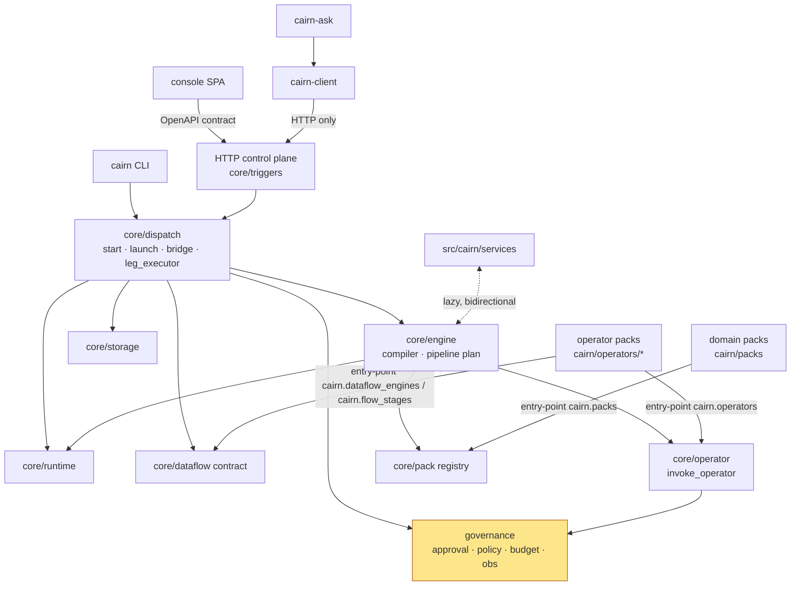

# Cairn architecture — overview

## Contract separation and migration direction

**DOCUMENTED maintainer scope / PROPOSED design:** [architecture 19](19-contracts-and-operator-migration.md)
describes independently discoverable contracts, capability-only domain composition and
one capability identity per operator. [ADR-0111](../decisions/ADR-0111-contracts-capabilities-and-pack-separation.md)
is still proposed. The [migration plan](../architecture-fix/operator-contract-migration-plan.md)
covers every operator and selected domain packs, preserving legacy consumers. Read these
before related changes; the CURRENT implementation described below is not silently replaced.

> **Read this first.** It is the entry point of the developer knowledge system under
> `docs/architecture/` and `docs/golden-paths/`. Every statement is tagged:
> **OBSERVED** (confirmed in source at HEAD `81d876ae`, 2026-09-10) ·
> **DOCUMENTED** (stated by an existing doc/ADR) · **INFERRED** (our interpretation) ·
> **CONFLICT** (doc and code disagree). Unmarked table rows are OBSERVED.

## 1. What is Cairn?

Cairn is a **governed control plane for AI/ML work**: it runs the pipelines that prepare
datasets, fine-tune, evaluate, compress and serve models, and puts a chokepoint in front
of every step that spends money, touches sensitive data or changes production
(DOCUMENTED: `README.md`; the pitch is corroborated by the code — see
[08-governance.md](08-governance.md)).

Concretely it is:

- one Python distribution, `cairn` (`pyproject.toml`), containing the **engine**
  (`src/cairn/core/`), core-adjacent **services** (`src/cairn/services/`), the **CLI**
  (`src/cairn/cli/`) and nine **domain packs** (`cairn/packs/`);
- **37 operator packs** on disk under `cairn/operators/{builtins,official}/` (14 + 23), each
  its own wheel in a uv workspace (all 37 are workspace members; `redteam` joined in #2289,
  `rag_parse` was retired in #2413, `remote` became a builtin in #2427, `secrets_infisical` in
  ADR-0127 D3, `train_local` joined
  with ADR-0127 D4, OBSERVED);
  113 operator entry points, all discoverable in a normal install (full inventory:
  16-capability-catalog.md);
- three satellite wheels: `client/` (`cairn-client`, typed API client; public), `ask/`
  (`cairn-ask`, the NL copilot) and `sdk/` (`cairn-sdk`, authoring projection) — the last
  two are the platform's (ADR-0127 D7, ADR-0135);
- a React/Vite **console** (`console/`, 209 TS files) bound to the engine through a
  committed OpenAPI contract (`console/openapi.json`, 207 paths).

Scale: ~96k lines in `src/cairn/core` (340 files), ~63k in operator packs, ~11k CLI, ~44k
console TypeScript, 5,046 test functions under `tests/` plus 1,520 inside operator packs.

## 2. Mental model (VERIFIED against source; the constitution in the root `CLAUDE.md` carries the same ladder)

```
User surfaces          cairn CLI · HTTP control plane (core/triggers) · console → HTTP · MCP → HTTP · cairn-client
      ↓
Dispatch               dispatch/start.py:179 resolve_start_ref → launch_pipeline (pipeline_launch.py:162);
                       a bare flow ref is REFUSED (start.py:69 FlowNotRunnableError, ADR-0106 D1)
      ↓
Pipeline / workflow    engine/pipeline.py:906 plan_pipeline → policy/pipeline_gates.py:93 inject_policy_gates
                       → PipelineBridge.start_pipeline (pipeline_bridge.py:561). Only a declared pipeline runs
                       (ADR-0106 D1); synthesize_flow_pipeline (start.py:261) survives only for the no-orphan
                       chokepoint in RunDispatcher.run_template (dispatcher.py:686, ADR-0106 D7).
      ↓
Governed legs          pipeline_bridge.py:862 _submit_step — flow, task and template legs each create a Run
                       (storage/protocols.py:136); gate legs record a verdict or wait for a human, no Run.
      ↓
template   |   flow    |   task
      ↓            ↓           ↓
LangGraph      Dataflow    Operator        template: dispatcher.py:565 run_template → compiler.py:92 → Runtime.invoke
Runtime        Engine      invocation      flow:     leg_executor.py:114 execute_leg → engine_registry.py:102 → DataflowEngine
                                           task:     pipeline_bridge.py:1294 _invoke_task_op → enforce_gate → Operation.run
      ↓
Governance + persistence   approval/enforce.py (enforce_gate :116, enforce_flow_gate :173) · budget_reservations.py
                           · services/llm/factory.py:97 build_chat_model (redaction, cost) · obs/audit.py:140 ·
                           RunStore · PipelineRecord · ArtifactStore · operator/pins.py
```

Caveats the ladder hides (all OBSERVED):
- Governance also runs **above** the legs: plan-time policy gates at the launch door and the
  admission doors inside `run_template` (holdout, intake, license, job-channel …).
- The template branch reaches operator invocation too: operation nodes call `invoke_operator`
  (`compiler.py:1633`), so "Operator invocation" is the *primary* executor of task legs, not
  the only place operators run.
- The Temporal owner (`runtime/temporal/pipeline_workflow.py`) is a second implementation of
  the "Pipeline" and "Governed legs" rows, selected by `CAIRN_RUNTIME=temporal`.
- One entry bypasses the ladder: `cairn run <pack>/<template>` compiles and runs in-process
  (`cli/commands/run.py:332,348`) — see 15-architecture-risks.md C1.

**One sentence:** *a pipeline is a DAG of legs; every leg is a governed `Run`; a leg is
either an agentic template (LangGraph), a data/ml flow (an engine adapter behind
`submit/poll/result`), or a single operator task; governance is a set of functions every
leg path calls.*

## 3. Major architectural boundaries

| Boundary | Where | One-line purpose | Detail |
|---|---|---|---|
| Entry surfaces | `src/cairn/cli/`, `src/cairn/core/triggers/` (HTTP; MCP at `triggers/mcp.py`), `console/` | how a human or agent reaches the engine | [01-system-map.md](01-system-map.md) |
| Dispatch | `src/cairn/core/dispatch/` | the start door, run admission, pipeline advancement, leg execution | [13-pipelines.md](13-pipelines.md) |
| Engine (compiler) | `src/cairn/core/engine/` | template → LangGraph graph; `pipelines/*.yaml` → `PipelinePlan`; one expression language | [04-engine.md](04-engine.md) |
| Operator substrate | `src/cairn/core/operator/` + `cairn/operators/` | the `Operation` contract, registry, invocation chokepoint, remote jobs | [05-operators.md](05-operators.md) |
| Pack system | `src/cairn/core/pack/` + `cairn/packs/` | `Pack` contract, `pack.toml` manifest, entry-point discovery, profiles | [06-packs.md](06-packs.md) |
| Runtime | `src/cairn/core/runtime/` | how a compiled graph executes: in-process, DBOS, Temporal; checkpointer; reconciler | [07-runtime.md](07-runtime.md) |
| Dataflow contract | `src/cairn/core/dataflow/` | engine-neutral `DataflowSpec`; `DataflowEngine` protocol; engine selection | [07-runtime.md](07-runtime.md), [13-pipelines.md](13-pipelines.md) |
| Governance | `src/cairn/core/approval/`, `policy/`, `obs/`, `budget_reservations.py`, the admission "doors" | approval gate, policy, budget, redaction, audit | [08-governance.md](08-governance.md) |
| Storage & provenance | `src/cairn/core/storage/` + ~20 store modules at `src/cairn/core/*.py` | runs, events, artifacts, pipeline records, registries | [09-storage-and-provenance.md](09-storage-and-provenance.md) |
| Services | `src/cairn/services/` | LLM gateway/factory, MCP, memory, RAG (core-adjacent) | [02-dependency-model.md](02-dependency-model.md) |
| Domains | `cairn/packs/{training,dataset_readiness,serving,…}` | the runnable business units | 10 · 11 · 12 |

## 4. How the boundaries depend on each other



Arrows are OBSERVED import or entry-point directions (see
[02-dependency-model.md](02-dependency-model.md) for the counted edges and the
exceptions). The dotted edge is the one documented bidirectional coupling.

## 5. Primary execution model

1. **Start.** `POST /start` (`src/cairn/core/triggers/routers/start.py:114`) or the CLI resolves
   a ref (`src/cairn/core/dispatch/start.py:179 resolve_start_ref`) — only a declared pipeline can be
   started; a bare flow ref raises `FlowNotRunnableError` (`start.py:69`, ADR-0106 D1) — and calls
   the one door, `launch_pipeline` (`src/cairn/core/dispatch/pipeline_launch.py:162`). A `template:` leg
   later reaches `RunDispatcher.run_template` (`src/cairn/core/dispatch/dispatcher.py:737`).
2. **Plan + policy.** `plan_pipeline` (`src/cairn/core/engine/pipeline.py:906`) produces a
   `PipelinePlan`; `inject_policy_gates` (`src/cairn/core/policy/pipeline_gates.py:93`) adds
   environment-mandated gates before any record exists.
3. **Advance.** `PipelineBridge` (`src/cairn/core/dispatch/pipeline_bridge.py:273`) persists a
   `PipelineRecord` and submits each ready step by **leg kind** (`_submit_step`, :859):
   `gate` → verdict/approval; `flow:` → `execute_leg` (`leg_executor.py:114`) → a
   `DataflowEngine`; `task:` → `invoke` an operator with `enforce_gate`;
   `template:` → `run_template` (LangGraph).
4. **Govern.** Every operator invocation passes `enforce_gate`
   (`src/cairn/core/approval/enforce.py:116`); every LLM call passes `build_chat_model`
   (`src/cairn/services/llm/factory.py:97`) which redacts and meters cost; budget is
   reserved at admission (`budget_reservations.py`).
5. **Persist.** A `Run` (`src/cairn/core/storage/protocols.py:136`) per leg, append-only
   `RunEvent`s, content-addressed artifacts (`storage/artifacts.py`), the pipeline record
   (`storage/pipeline_store.py`), optional hash-chained audit via a bound operator.

## 6. Major domain packs (OBSERVED in `cairn/packs/` and `pyproject.toml` entry points)

| Pack | Pipelines dir | Notes |
|---|---|---|
| `training` | 13 pipelines, 17 flows | fine-tune, DPO, continual learning, verifiable-finetune |
| `dataset-readiness` | 5 pipelines | import, readiness loop, pull/api ingestion, watch |
| `serving` | 3 pipelines | serve, batch-inference, export-model |
| `compress`, `compute`, `eval` | yes | quantize/re-eval; GPU pricing; eval as a run |
| `incident` | yes | the original flagship (RCA, blast radius); needs `cairn_platform.integrations.observability` (the platform, #2497) |
| `security-triage`, `security-kb` | yes / knowledge only | knowledge packs are corpora, exempt from pipelines |

## 7. Engine vs Pack vs Operator vs Runtime

| Term | Is | Is not | Defined in |
|---|---|---|---|
| **Engine** | domain-neutral code in `src/cairn/core` that loads packs, compiles records, dispatches runs and enforces governance | anything that knows a domain noun | `src/cairn/core/__init__.py` docstring |
| **Pack (domain)** | data: `pack.toml` + `pipelines/`, `flows/`, `schemas/`, `policies/` … + a one-line `__init__.py` calling `Pack.from_manifest` | Python behaviour | `src/cairn/core/pack/protocol.py:124` |
| **Operator (pack)** | a wheel of `Operation` subclasses with Pydantic I/O, declared in `pack.toml` `[operator."x/y"]` and the `cairn.operators` entry-point group | a place for orchestration | `src/cairn/core/operator/protocol.py:261` |
| **Runtime** | how a compiled agentic graph executes (`Runtime` protocol: `src/cairn/core/runtime/base.py:123`) — in-process, DBOS, Temporal | the thing that runs data/ml flows (that is a `DataflowEngine`, `src/cairn/core/dataflow/engine.py:76`) | `src/cairn/core/runtime/__init__.py` |

## 8. Where to start reading the code

1. `src/cairn/core/dispatch/start.py` — the one start model; read `resolve_start_ref`.
2. `src/cairn/core/dispatch/pipeline_launch.py` → `src/cairn/core/engine/pipeline.py` — how a
   `pipelines/*.yaml` becomes a plan.
3. `src/cairn/core/dispatch/pipeline_bridge.py:862 _submit_step` — the leg-kind router.
4. `src/cairn/core/dispatch/leg_executor.py:114 execute_leg` — the engine waist.
5. `src/cairn/core/operator/runtime.py:888 invoke_operator` — the operator chokepoint.
6. `src/cairn/core/approval/enforce.py` — the approval gate.
7. `src/cairn/core/pack/loader.py` and `src/cairn/core/operator/loader.py` — discovery.
8. One pack end to end: `cairn/packs/training/pipelines/verifiable-finetune.yaml`,
   `cairn/packs/training/flows/finetune.yaml`, `cairn/operators/official/training/`.

Then the golden paths: [pipeline](../golden-paths/pipeline.md) ·
[operator](../golden-paths/operator.md) · training ·
dataset · serving ·
[hello-cairn, the public feature proof](../golden-paths/hello.md).

## 9. Relationship to existing documents

- `docs/architecture.md` is the older top-down narrative (incident-era vocabulary). Parts
  of it are stale; conflicts are listed in 15-architecture-risks.md §Conflicts.
- `docs/decisions/ADR-*.md` is the decision log (106 ADRs). `docs/adr/README.md` indexes it
  and lists **candidate** ADRs for decisions that exist only in code.
- `architecture.md` (repo root) points at ADR-0084, the current target architecture.

## Pending contract proposal

DOCUMENTED / PROPOSED: [ADR-0108](../decisions/ADR-0108-capability-contract-conformance.md) proposes semantic capability validation using existing pack, artifact and pipeline carriers. [Proposal details](18-proposed-contract-conformance.md) distinguish current evidence from intended changes. This is not adopted architecture and does not replace the frozen training baseline.

**DOCUMENTED profile-scope review:** consult [ADR-0112](../decisions/ADR-0112-profile-scope-and-enforcement.md) before changing deployment configuration. The proposed typed scope and compatibility requirements complement operator migration; they are not yet runtime enforcement.
