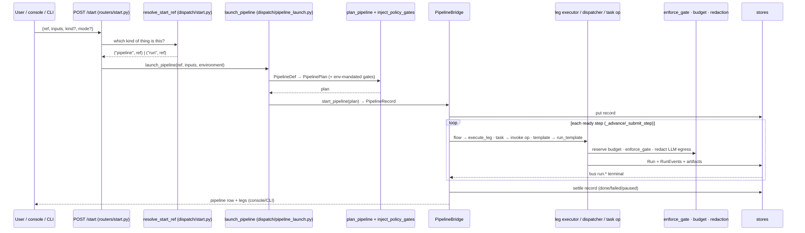

# System map

Tags: OBSERVED unless stated. HEAD `81d876ae`.

## A. Repository map — directory → responsibility → entry points

| Directory | Architectural responsibility | Important entry points |
|---|---|---|
| `src/cairn/core/dispatch/` | run admission, the one start door, pipeline advancement, leg execution, scheduler | `start.py:179 resolve_start_ref` (refuses a bare flow ref, `:69 FlowNotRunnableError`, ADR-0106 D1), `pipeline_launch.py:162 launch_pipeline`, `dispatcher.py:737 RunDispatcher.run_template`, `pipeline_bridge.py:273 PipelineBridge`, `leg_executor.py:114 execute_leg`, `scheduler.py:103 SkillScheduler` |
| `src/cairn/core/engine/` | template schema + compiler (LangGraph), pipeline definition + planner, expression language, skills | `compiler.py:92 compile_template`, `pipeline.py:187 parse_pipeline_def`, `pipeline.py:746 plan_pipeline`, `expr.py:465 compile_expr`, `runner.py:122 Runner`, `schema.py:473 TemplateSpec` |
| `src/cairn/core/operator/` | `Operation` contract, registry, entry-point loader, invocation chokepoint, executors, remote jobs, manifest sync | `protocol.py:261 Operation`, `registry.py:233 register_operator`, `loader.py:66 load_all_operators`, `runtime.py:888 invoke_operator`, `executor.py:113 pick_executor`, `jobs.py`, `job_store.py` |
| `src/cairn/core/pack/` | `Pack` contract, `pack.toml` manifest, entry-point + dev-dir discovery, registry aggregators, composition validation, profiles | `protocol.py:124 Pack`, `manifest.py:675 load_manifest`, `loader.py:371 load_all_packs`, `registry.py:143.. all_*()`, `composition.py:179 validate_composition`, `profile.py:179 load_profile` |
| `src/cairn/core/approval/` | the HITL gate: resolver + enforcement + the single runtime PolicyEngine | `enforce.py:88 resolve_runtime_gate`, `enforce.py:116 enforce_gate`, `enforce.py:173 enforce_flow_gate`, `resolver.py:76 resolve_gate`, `policy_source.py:61 runtime_policy_engine` |
| `src/cairn/core/policy/` | YAML policy evaluation; plan-time gate injection; policy store | `engine.py:176 PolicyEngine`, `pipeline_gates.py:93 inject_policy_gates`, `store.py` |
| `src/cairn/core/obs/` | cost scope, redaction seam, audit seam, run/request events, replay, telemetry | `cost.py:44 record_llm`, `redact.py:78 get_redactor`, `audit.py:140 audit_emit`, `events.py`, `telemetry.py` |
| `src/cairn/core/runtime/` | how a compiled graph executes; checkpointer tiers; zombie reconciler | `__init__.py:30 select_runtime`, `inprocess.py:26`, `temporal/runtime.py:32`, `temporal/pipeline_workflow.py:63`, `dbos/runtime.py:98`, `checkpointer.py:91`, `reconciler.py:272` |
| `src/cairn/core/dataflow/` | engine-neutral data-plane contract; `DataflowEngine` protocol; engine selection; flow defs | `contract.py:179 DataflowSpec`, `engine.py:76 DataflowEngine`, `engine_registry.py:102 resolve_engine`, `defs.py:67 FlowDef`, `defs.py:413 resolve_flow_ref` |
| `src/cairn/core/storage/` | `Run`/`RunEvent`/`RunStore` + memory/sqlite/postgres; artifacts; pipeline records; judges, reviews, eval ledger, capture, fingerprints, training runs | `protocols.py:136 Run`, `protocols.py:426 RunStore`, `__init__.py:74 default_store`, `artifacts.py:1273 build_artifact_store`, `pipeline_store.py:341 default_pipeline_store` |
| `src/cairn/core/triggers/` | the FastAPI control plane (app factory + 29 routers), JWT auth, webhook ingress, declared triggers, schedules; ADR-0120 D2 as amended (#2427, ADR-0123 D1): `jobs` (the pull lane) and `oauth` (`/oauth/callback`) are D2, `ask` is the platform's | `main.py:main` (`cairn-server`), `server.py:505 build_app`, `routers/start.py:96`, `routers/pipelines.py:24`, `routers/runs.py:92`, `auth.py`, `declared.py:320` |
| `src/cairn/core/*.py` (60 modules) | **un-bounded top level**: workspace, account, connections, settings, doors (holdout/intake/license), registries, stores, seeds, deploy checks | `settings.py`, `workspace.py:56 current_workspace`, `budget_reservations.py`, `workflow_registry.py`, `app_client.py:74 app_client`, `preflight.py`, `validate.py` |
| `src/cairn/core/{guards,eval,llm,bus,clients,oauth,playground,backends,schema}/` | deterministic guards; eval scoring; LLM client + models; in-process bus; OAuth broker; playground; `BackendProtocol`; `schema://` registry (the console read-API and the chat router are the platform's, `packages/cairn-platform`, #2427; the action saga is the platform's `cairn_platform.actions`, #2497) | `guards/citation_validator.py`, `llm/client.py:llm_complete`, `bus/__init__.py:154 get_bus`, `schema/registry.py:52` |
| `src/cairn/services/` | core-adjacent infrastructure: LLM gateway + chat-model factory, MCP client, memory, RAG | `llm/factory.py:97 build_chat_model`, `llm/gateway.py`, `mcp/client.py`, `rag/query.py`, `memory/store.py` |
| `cairn/operators/builtins/` (14) | substrate operator packs the engine's own services bind to (memory, artifacts, RAG, MCP, redaction, audit, secrets — env and Infisical, dataflow doors + engines, remote exec over SSH — `remote` joined in #2427, `secrets_infisical` in ADR-0127 D3 — and a CPU LoRA fine-tune, `train_local`, ADR-0127 D4) | each `pack.toml` + `src/operator_<name>/operators/*.py`; `dataflow/pyproject.toml` declares `cairn.dataflow_engines` |
| `cairn/operators/official/` (23) | first-party domain operators (training, serving, dataset_checks, eval*, compute, compress, model_registry, ingest, s3, git, clickstack, …) | e.g. `training/src/operator_training/operators/local.py`, `serving/.../vllm_serve.py:132`, `dataset_checks/.../operators/*.py` |
| `cairn/packs/` (12 dirs) | domain packs: data only + one-line `__init__.py` | `<pack>/pack.toml`, `<pack>/pipelines/*.yaml`, `<pack>/flows/*.{yaml,md}` |
| `src/cairn/profiles/` | deployment profiles (TOML): bindings capability→operator, backends, config | `local-dev.toml`, `secure.toml`, `production.toml` |
| `src/cairn/cli/` | the `cairn` Typer CLI: 25 command modules; the product-only commands (`ask`, `pilot`, `series`, `showcase`, `eval`, `suggest`, `knowledge`) are the platform's, mounted through the `cairn.cli` entry-point group (`providers.py`, #2421; `ask`, ADR-0134 D6); a hidden `ask` stub mounts only when no provider supplied `ask` | `main.py:app`, `commands/run.py:583 cmd`, `commands/pipeline.py:211 run_pipeline`, `commands/doctor.py` |
| `packages/cairn-platform/src/cairn_platform/ask/` (platform, ADR-0134 D6) | engine wiring for the `cairn-ask` wheel (binds seams at import); the `ask` command is `cairn_platform/cli/ask.py` | `__init__.py` |
| `packages/cairn-platform/src/cairn_platform/integrations/observability/` (platform, #2497) | observability backends (`ObsBackend` ABC, mock/otel/clickstack) used by the incident domain | `base.py:83 ObsBackend` |
| `client/`, `ask/`, `sdk/` | satellite wheels; import nothing from `cairn.core` (client: CI-tested); only `client/` is public (ADR-0135) | `packages/cairn-client/src/cairn_client/__init__.py`, `ask/src/cairn_ask/agent.py`, `sdk/src/cairn_sdk/compiler.py` |
| `console/` | React + Vite SPA; `openapi.json` is the committed contract; design rules in `DESIGN.md` | `src/routes.tsx`, `src/views/*`, `scripts/check-design-rules.mjs` |
| `tests/` | engine/core/CLI/integration tests (545 files, 455 in `tests/core`) | `conftest.py` neutralises `.env` |
| `deploy/` | prod compose + Caddy, light compose, helm chart, GPU image | `prod/docker-compose.yml`, `light/`, `helm/cairn`, `images/train-gpu` |
| `docs/` | ADRs (`decisions/`), audits, roadmap, status probes, this knowledge system | `decisions/README.md`, `status.yaml`, `audits/` |
| `scripts/` | CI gates and ops scripts | `check_public_set.py`, `check_change_scope.py` |

## B. Architecture map

```mermaid
flowchart LR
  subgraph Surfaces
    CLI[cairn CLI]:::s
    API[HTTP control plane<br/>triggers/server.py build_app]:::s
    UI[console SPA]:::s
    MCP[MCP tool server<br/>triggers/mcp.py]:::s
  end
  subgraph ControlPlane["cairn.core — control plane"]
    START[dispatch/start.py<br/>resolve_start_ref]
    LAUNCH[dispatch/pipeline_launch.py]
    DISP[dispatch/dispatcher.py<br/>RunDispatcher]
    BRIDGE[dispatch/pipeline_bridge.py<br/>PipelineBridge]
    LEG[dispatch/leg_executor.py]
    PLAN[engine/pipeline.py → PipelinePlan]
    COMP[engine/compiler.py → LangGraph]
    INV[operator/runtime.py<br/>invoke_operator]
    GATE[approval/enforce.py]:::g
    POL[policy/engine.py · pipeline_gates.py]:::g
    BUD[budget_reservations.py]:::g
    RED[obs/redact.py · services/llm/factory.py]:::g
    STORE[(storage: runs · artifacts · pipeline records)]
    RT[runtime: inprocess · dbos · temporal]
    DF[dataflow: DataflowSpec · engine_registry]
  end
  subgraph Extensions["installed via entry points"]
    DP[domain packs<br/>cairn.packs]
    OP[operator packs<br/>cairn.operators]
    ENG[dataflow engines<br/>cairn.dataflow_engines]
    STG[flow stages<br/>cairn.flow_stages / cairn.dataflow_stages]
  end
  CLI --> START; API --> START; UI --> API; MCP --> API
  START --> LAUNCH; START --> DISP
  LAUNCH --> PLAN --> POL --> BRIDGE
  BRIDGE -->|template leg| DISP --> COMP --> INV --> GATE
  BRIDGE -->|task leg| INV
  BRIDGE -->|flow leg| LEG --> DF --> ENG --> STG
  DISP --> BUD; LEG --> BUD
  COMP --> RT; COMP --> RED
  DISP --> STORE; BRIDGE --> STORE; LEG --> STORE
  DP -.registry.-> PLAN; DP -.registry.-> COMP
  OP -.registry.-> INV
  classDef s fill:#e0f2fe,stroke:#0369a1; classDef g fill:#fde68a,stroke:#b45309;
```

## C. Dependency direction

Allowed (DOCUMENTED in root `CLAUDE.md` §3, `pyproject.toml` comments, ADR-0084 D1,
ADR-0085 D7) and observed status:

| Rule | Status | Evidence |
|---|---|---|
| packs → core, never core → `cairn.packs.*` | **VIOLATED (2 lazy imports)** | `src/cairn/core/models_catalog.py:100`, `src/cairn/core/recommender.py:102` import `cairn.packs.training` |
| core never imports an operator pack | **CONFIRMED** | `tests/core/test_engine_registry.py::test_core_never_imports_an_operator_pack` (AST walk) |
| `client/` imports nothing from `cairn` | **CONFIRMED** | `tests/core/test_cairn_client_contract.py::test_client_imports_nothing_from_cairn_core` |
| `ask/`, `sdk/` import nothing from `cairn.core` | OBSERVED TRUE; enforcement **UNCLEAR** (no test found; `pyproject.toml` says "CI-enforced") | import graph: `sdk→cairn_client` only |
| services ↔ core bidirectional but lazy | OBSERVED (all core→services edges are function-local) | see [02-dependency-model.md](02-dependency-model.md) |
| services never import packs | **CONFIRMED**: every `src/cairn/services` module is AST-checked (#2425); `rag/inject.py` resolves `rag/search` by ref through the operator registry (#2415) | `tests/core/test_mcp_server_layering.py` |
| LangGraph never on the data path | **CONFIRMED** | `tests/core/test_leg_executor.py::test_a_data_leg_never_imports_langgraph` |

Full edge counts and the cycle list: [02-dependency-model.md](02-dependency-model.md).

## D. Runtime flow — request to result



## E. Developer navigation — "if I want to change X, start here"

| Task | Start here | Also touch | Verify with |
|---|---|---|---|
| Add an operator | copy a pack under `cairn/operators/official/<pack>/`; subclass `Operation` (`src/cairn/core/operator/protocol.py:261`); declare in `pack.toml` `[operator."x/y"]` **and** `pyproject.toml` `[project.entry-points."cairn.operators"]`; add to root `pyproject.toml` workspace + deps | `DESIGN.md` (mandatory, `tests/core/test_pack_design_docs.py`), pack-local `tests/`, `uv run cairn lock` | install the pack (`uv pip install -e <pack> --no-deps`), `tests/core/test_operator_manifest_sync.py`, `tests/core/test_pack_manifest_drift.py` |
| Add a training capability | `cairn/operators/official/training/` (operators or `flow_stages.py` via `cairn.flow_stages`) and the domain record `cairn/packs/training/{flows,pipelines}/` | `DESIGN.md`, `cairn.lock` | pack tests; `tests/core/test_training_pack.py`, `test_verifiable_finetune_pipeline.py` |
| Change how a leg executes | `src/cairn/core/dispatch/leg_executor.py` (flow legs), `pipeline_bridge.py:_submit_task_leg/_run_task_leg` (task legs), `dispatcher.py:_run_template_task` (agentic) | `runtime/temporal/pipeline_activities.py` (parity!), `dispatch/leg_hooks.py` | `tests/core/test_leg_executor.py`, `test_pipeline_bridge*.py`, `test_temporal_owner_leg_kinds.py` |
| Change policy / gates | `src/cairn/core/approval/enforce.py`, `resolver.py`; `src/cairn/core/policy/engine.py`, `pipeline_gates.py` | `approval/policy_source.py` (the one evaluator) | `tests/core/test_approval_*.py`, `test_policy_*.py` |
| Add a pipeline step kind or field | `src/cairn/core/engine/pipeline.py` (`PipelineStep`, `_validate_step`, `lower_step`) → `engine/bundle_pipeline.py` (`PipelinePlan`) → `dispatch/pipeline_bridge.py:_submit_step` | `engine/pipeline_explain.py`, `console` graph views | `tests/core/test_pipeline_*.py` (34 files) |
| Modify storage | the store module (e.g. `src/cairn/core/storage/pipeline_store.py`) — keep the memory/sqlite/postgres triad in step; migrations via `storage/migrations.py` (sqlite) and `pg_schema_init.py` | `storage/__init__.py` factory if a new store | store tests + `tests/core/test_storage_resolver.py` |
| Change the CLI | `src/cairn/cli/commands/<verb>.py`; register in `src/cairn/cli/main.py` | prefer calling a `dispatch/` door, not compiling directly | `tests/cli/` |
| Add a domain pack | `cairn init pack` → `pack.toml` + `pipelines/` + `flows/`; register in root `pyproject.toml` `[project.entry-points."cairn.packs"]` (or `CAIRN_PACK_PATH` for dev) | `cairn.lock` | `cairn doctor`, `tests/core/test_pack_*.py` |
| Add an HTTP route | `src/cairn/core/triggers/routers/<surface>.py`, include in `server.py:build_app` | regenerate `console/openapi.json` (`scripts/dump_openapi.py`), console `npm run gen:api`, vite `API_PATHS` | `tests/core/test_openapi_contract.py`, CI oasdiff |
| Modify serving | `cairn/operators/official/serving/src/operator_serving/operators/*.py`; `cairn/packs/serving/{pipelines,flows}/` | `DESIGN.md` | `cairn/operators/official/serving/tests/`, `tests/core/test_serve_leg_pipeline.py` |
| Change a governance knob's scope | read ADR-0068/0070 first: `config_schema` at governance scope is environment-owned (run values are dropped) | `src/cairn/core/operator/config.py`, `effective.py` | `tests/core/test_operator_config.py` |
