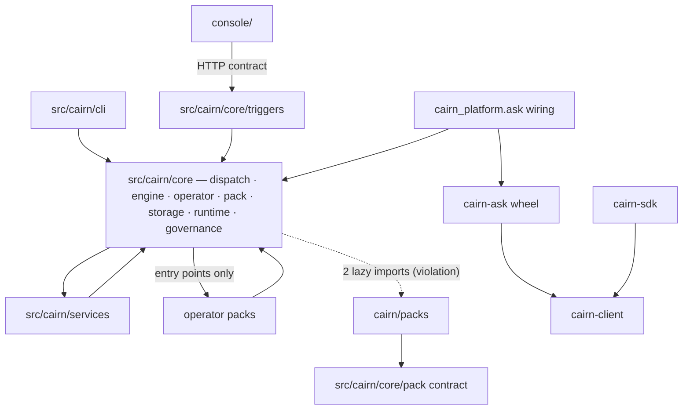

# Dependency model

Method (OBSERVED): every `import` in `cairn/`, `sdk/`, `client/`, `ask/` (excluding tests,
examples, docs) was parsed with `ast`, mapped to an architectural unit, and counted. A
second pass classified each edge as **top-level**, **function-local (lazy)** or
**TYPE_CHECKING-only**. Scripts are not committed; the method is reproducible with any
AST walker. HEAD `81d876ae`.

## Level 1 — major boundaries



Legend: solid = observed static import direction; dotted = observed violation of a
documented rule. Operator packs import `cairn.core.operator` (the contract) and, in
several cases, deeper engine modules (see "Forbidden-looking dependencies").

## Level 2 — package/module edges (counts = import statements)

### Inside `cairn.core` (top counts)

| From → To | Count | Note |
|---|---|---|
| `core/triggers` → `core/<top-level modules>` | 136 | the HTTP layer reaches into the un-bounded core root |
| `core/<top>` → `core/storage` | 41 | top-level store modules |
| `core/dispatch` → `core/<top>` | 37 | doors, budget, workspace |
| `core/dispatch` → `core/engine` | 32 | plan + compile |
| `core/triggers` → `core/storage` | 28 | routers read stores directly |
| `core/<top>` → `core/pack` | 27 | |
| `core/console` → `core/<top>` | 26 | server-side console read-API |
| `core/triggers` → `core/engine` | 24 | |
| `core/triggers` → `core/dispatch` | 23 | |
| `core/engine` → `core/operator` | 21 | compiler binds operators |
| `core/<top>` → `core/engine` / `core/operator` | 20 / 20 | |
| `core/dispatch` → `core/dataflow` | 14 | leg executor |
| `core/engine` → `core/runtime` | 9 | compiler selects runtime |
| `core/engine` → `core/dispatch` | 8 | **reverse edge** (cycle) |
| `core/runtime` → `core/dispatch` | 8 | **reverse edge** (cycle) |

### Central module (highest fan-in + fan-out)

`src/cairn/core/<top-level>` — 60 modules, ~20k lines, no package boundary. It is imported by
every other unit (fan-in) and imports storage, pack, engine, operator, runtime, triggers,
dataflow, packs (fan-out). INFERRED: this is the de-facto "shared kernel" and the single
largest source of coupling.

### Cycles (OBSERVED; almost all broken by function-local imports annotated `# cycle`)

| Cycle | Where the lazy import lives |
|---|---|
| `engine` ↔ `dispatch` | `engine/pipeline.py` ↔ `dispatch/pipeline_launch.py`, `dispatch/pipeline_bridge.py` |
| `engine` ↔ `operator` | `operator/runtime.py:948` imports `approval.enforce` lazily; compiler imports operator runtime at top |
| `approval` ↔ `operator` ↔ `engine` | `operator/runtime.py:948 # cycle: approval → operator` |
| `dispatch` ↔ `runtime` | `runtime/temporal/pipeline_activities.py` builds a dispatcher; compiler resolves runtimes |
| `dispatch`/`engine`/`pack`/`storage` ↔ `triggers` | see below |
| `storage` ↔ `services` (episodic, rag) | `storage/episodic.py:45`, `storage/rag.py:49` |
| `policy` → `approval` → `engine.runner` → `dispatch` | `pipeline_launch.py:275 # cycle: policy → approval → engine.runner → dispatch` |

### Forbidden-looking dependencies

| Edge | Kind | Evidence | Assessment |
|---|---|---|---|
| core → `cairn.packs.training` | lazy | `src/cairn/core/models_catalog.py:100`, `src/cairn/core/recommender.py:102` | **VIOLATES** the documented hard rule (root `CLAUDE.md` §3, "Core never imports `cairn.packs.*`"); used only to locate the pack's `models/` and `recommender/` data dirs |
| `pack/composition.py` → `triggers` (the `TriggerProvider` registry) | lazy | `composition.py:324` | pack layer validates trigger sources against the provider registry; its home is open (#2416). The grammar, spec loader, stores, inbox and token helpers moved below the HTTP layer in #2416 (`engine/triggers_{grammar,spec,presets}.py`, `storage/{schedule_store,trigger_store,trigger_inbox}.py`, `core/auth_tokens.py`) |
| `app_client.py` → `triggers.{main,server}` | lazy | `:67,68` | builds the HTTP app in-process (a surface helper; home open, #2416) |
| `services/rag/inject.py` → `rag/search` (by ref, operator registry) | lazy | `:65-67` | no pack import since #2415; the C-6 test `test_mcp_server_layering.py` checks every `src/cairn/services` module (#2425) |
| `operator_monitor_threshold` → `core.dispatch.{dispatcher,pipeline_bridge,pipeline_launch}`, `core.engine.runner` | lazy | `.../operators/dispatch.py:67-82` | an operator pack drives the dispatcher (it is the "monitor → dispatch" operator). INFERRED: legitimate purpose, but the pack depends on engine internals, not the operator contract |
| `operator_ingest` → `core.storage.schedule_store` | lazy | `.../operators/watch.py:86,100` | pack writes its watch marker on its schedule row (no longer the HTTP layer, #2416) |
| `operator_notify_slack` → `core.engine.schema` | top-level | `.../operators/slack.py:22` | pack imports engine schema types |
| `operator_dataflow` → `operator_remote` | lazy | `engines_ssh.py:232,333,384` | **pack → pack** import (training pyproject comment says "cross-pack imports are not allowed") |
| `cairn/packs/incident/__init__.py` → `cairn_platform.integrations.observability.mock.backend` | lazy | `:16` | a domain pack carries Python beyond `Pack.from_manifest` (the only one) |

### Documented and honoured

- All `core → services` edges are function-local (gateway, rag, memory seams) as
  root `CLAUDE.md` §3 describes.
- `core → operator packs`: zero static imports (test-enforced); engines and stages are
  reached through entry-point groups `cairn.dataflow_engines`, `cairn.flow_stages`,
  `cairn.dataflow_stages` (`src/cairn/core/dataflow/engine_registry.py`, `defs.py:98`).
- `client/` has no `cairn` import (test-enforced). `sdk/` imports only `cairn_client`; it is the
  platform's, not part of the public core (ADR-0135).
  `ask/` (the wheel) imports only `cairn_client`; the platform's `cairn_platform/ask/__init__.py`
  binds seams lazily (ADR-0134 D6: the wiring left the public core).

## Level 3 — critical runtime dependencies (the pipeline path)

```
entry point     src/cairn/core/triggers/routers/start.py:111  start_anything
                src/cairn/cli/commands/pipeline.py:211        run_pipeline
    ↓
resolver        src/cairn/core/dispatch/start.py:179          resolve_start_ref
                src/cairn/core/dispatch/pipeline_launch.py:66 resolve_or_raise → engine/pipeline_resolve.py:92
    ↓
compiler        src/cairn/core/engine/pipeline.py:187         parse_pipeline_def → :746 plan_pipeline → PipelinePlan
                src/cairn/core/policy/pipeline_gates.py:93    inject_policy_gates
    ↓
dispatcher      src/cairn/core/dispatch/pipeline_bridge.py:558 start_pipeline → :780 _advance → :859 _submit_step
    ↓
operator        task leg:  pipeline_bridge.py:1294 _invoke_task_op → approval/enforce.py:116 enforce_gate → Operation.run
                template:  dispatcher.py:565 run_template → engine/compiler.py:92 → operator/runtime.py:888 invoke_operator
                flow leg:  dispatch/leg_executor.py:92 execute_leg
    ↓
executor/runtime  agentic: runtime/inprocess.py | runtime/dbos | runtime/temporal (compiler.py:792 _resolve_runtime)
                  flow:    dataflow/engine_registry.py:102 resolve_engine → DataflowEngine.submit/poll/result
    ↓
persistence     storage/protocols.py Run/RunEvent via RunStore · storage/pipeline_store.py PipelineRecord
                storage/artifacts.py register · budget_reservations.py settle
    ↓
result          bus `run.*` terminal → pipeline_bridge.py:604 _on_run_terminal → :1835 _settle
                console: routers/pipelines.py, routers/runs.py
```

Entry-point groups that stitch extensions in (OBSERVED in `pyproject.toml` files):

| Group | Consumer | Producers |
|---|---|---|
| `cairn.packs` | `src/cairn/core/pack/loader.py:610` | root `pyproject.toml` (9 domain packs) |
| `cairn.operators` | `src/cairn/core/operator/loader.py:66` | each operator pack `pyproject.toml` |
| `cairn.dataflow_engines` | `src/cairn/core/dataflow/engine_registry.py:46,74` | `operators/builtins/dataflow` (builtin, metaflow, skypilot) |
| `cairn.flow_stages`, `cairn.dataflow_stages` | `src/cairn/core/dataflow/defs.py:98 _stage_entry_points` | `operator_training`, `operator_dataflow`, `operator_dataset_checks`, … |
| `cairn.vector_stores` | `src/cairn/services/rag/stores` | `src/cairn/providers/vectorstores` |
| `cairn.routers` (ADR-0120 D4) | `src/cairn/core/triggers/router_providers.py` `mount_router_providers` (from `build_app`) | `packages/cairn-platform/pyproject.toml` (the root registers none since #2427; absent → the server mounts the public API only) |
| console scripts | `cairn`, `cairn-server`, `cairn-worker`, `cairn-admin`, `cairn-dataflow-run` | root + dataflow pack |
