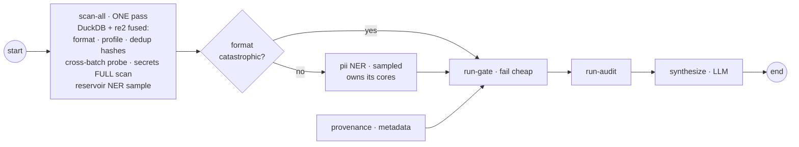
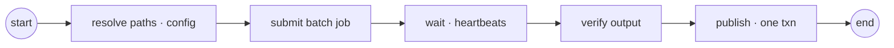

# ADR-0080 — Dataset data-plane separation: batch jobs, fused checks, indexed fingerprints

Status: Proposed (2026-07-20)

Relates to / builds on: ADR-0078 (columnar data plane — this ADR **un-defers A2
parquet intermediates** and **re-scopes A5 content-fingerprints from parquet to
Postgres**), ADR-0079 + #1021 (PII cascade + the measured throughput numbers
this ADR's sizing math rests on), ADR-0069/#746 + #565 (the remote-job spine
and dedicated-queue worker routing this ADR generalizes from training to
dataset ops), #962 (Shardable pool — superseded on the fix path by job-per-
batch), #1007/#1008/#1010 (atomic writes, quarantine, shard-manifest resume —
the idempotency substrate), F1/F2 live-run findings on #1021 (blanket IO
timeout, per-activity re-streaming).

## Context — where the current architecture actually breaks

cairn's dataset workflows (`dataset-readiness/check`, `/fix`) compile from pack
templates into a LangGraph graph; under `OBS_RUNTIME=temporal` each node runs
as one Temporal activity **on the same worker that runs everything else**. The
2026-07 live runs on the 2-vCPU control-plane box surfaced the failure class:

- The whole sharded anonymize ran as ONE IO activity → blew the 300 s timeout →
  raised to a blanket 1800 s (#1023) — a symptom patch, not a fix (F1).
- Dataset ops on a HF Hub id re-streamed the entire dataset per activity (F2).
- The Shardable in-process pool resolves `cores − 2 = 0` on a 2-core box; the
  worker's Presidio pass saturated the box (SSH stalls, OOM risk next to
  postgres + temporal).
- Presidio throughput was measured (200k-row standalone experiment, 2 vCPU):
  **~250 rows/s per vCPU** for the cascade (sm or lg, `n_process=2`, large
  analyze-chunk); regex-only ~2× lighter in RAM. 200k rows ≈ 7 min on 2 vCPU,
  flat memory. The bottleneck is CPU cores, never the dataframe layer.

Target scale for this ADR: **~1M-row batches, up to ~100 batches/day**
(~1,157 rows/s sustained). At measured throughput that needs ≥5 dedicated vCPU
for PII alone — impossible on a shared control-plane box, comfortable on one
right-sized machine. External reviews (Temporal design rules; Polars/DuckDB
sizing) converged on the same shape; this ADR records the cairn-specific
design **and the seven rejected designs, five of which we invented and then
falsified ourselves**.

## Decision

### D1 — Control plane / data plane split by task queue

Three Temporal task queues, routed per node at compile time (the #565
`tag(queue=)` mechanism, extended from remote-job operators to dataset
operators):

| Queue | Worker | Runs | Slots |
|---|---|---|---|
| `cairn` | control-plane worker (existing) | workflow replay, gate, audit, eval, synthesize (LLM), HITL wait | many (light) |
| `cairn-data` | fast-check worker(s) | check-pipeline activities — stateless reads of shared storage | N (I/O-light) |
| `cairn-jobs` | batch job machine(s) | the fix job — one whole batch | **1** (job owns the box) |

The pack contract is untouched: packs stay data; the queue is a property of the
operator/binding, not the template.

### D2 — Check pipeline: fused linear scan, two-tier PII, guard early-exit



- **The parallel check block is retired** (rejected design R7). Four of the six
  checks are single-pass row scans of the same data; they fuse into one
  `dataset/scan_all` operation — one read, one activity. `provenance`
  (metadata-only, free) is the one branch that stays parallel.
- **Two-tier PII** (closes rejected design R4): the deterministic tier
  (secrets/regex, re2) scans **every row** inside scan-all — rare absolute
  blockers cannot hide from sampling. The NER tier stays sampled (density
  estimate, ±3% at n=1000) and reads only the reservoir sample drawn during
  scan-all, so its cost is constant in dataset size.
- Guard early-exit: a structurally dead dataset (conformance below floor)
  fails the gate without spending a second of NER.
- Existing operators (`dataset/format`, `dataset/dedup`, …) remain in the pack
  as independently-usable units; `check.md` binds the fused operation. The
  `state.findings` keys the gate cites are unchanged.

### D3 — Fix pipeline: one node = one submitted batch job



The fix's data work — normalize → dedup-apply → redact over **all** rows (a
redaction cannot sample) — executes as **one job on one machine**, dispatched
via the remote-job spine already proven live for training (submit → heartbeat/
poll → resume; durable across restarts; cancel kills the remote process,
#601/#603). Inside the job, on local NVMe:

1. stage `dataset_uri` → local scratch (once);
2. normalize → parquet (DuckDB, all cores);
3. dedup-apply — anti-join the **Postgres fingerprint index** (D5);
4. redact — ADR-0079 cascade, `n_process = cores` (finally correct, because
   the job owns every core — see R2);
5. write parquet parts + report to shared storage;
6. `publish`: fingerprint upsert + `_manifest.json` in **one transaction**.

Scale-out is per batch: ten concurrent batches = ten job machines, one job
each. **A batch never spans workers** (see R1). `MapBTNode`/dynamic fan-out is
off the critical path entirely (see R6).

### D4 — DuckDB inside operators; parquet intermediates (ADR-0078 A2, un-deferred)

DuckDB is the relational engine **inside** operator bodies — normalize,
hash-dedup, profile SQL, the fingerprint anti-join, quality aggregates. It is
deliberately NOT used for the PII stage: ~90% of that CPU is spaCy NER inside
Presidio; the engine feeding it is irrelevant (measured). Polars was rejected
for lacking a persistence/SQL-audit story. The graph, the engine, and the packs
never learn what DuckDB is.

Intermediates and outputs are parquet under a deterministic layout:

```
{prefix}/{dataset_id}/{batch_id}/{pipeline_version}/
  raw/ · normalized/ · quarantine/ · redacted/ · report/ · _manifest.json
```

`_manifest.json` is written **last** — the atomic commit marker (#1007
pattern). A retried activity/job finds its deterministic output and returns.

### D5 — Fingerprints: Postgres, transactional, indexed (re-scopes ADR-0078 A5)

Cross-batch dedup state lives in a Postgres table (already in the stack):
`fingerprints(hash PRIMARY KEY, dataset_id, batch_id, created_at)`.

- Anti-join = indexed lookup: **O(batch), not O(history)** (see R3a).
- Publish performs `INSERT … ON CONFLICT DO NOTHING` **in the same transaction
  as the manifest commit** — two concurrent batches serialize at publish and
  cannot miss each other's rows (closes the write-skew, R3b).
- Retention/compaction is a table policy, not a file-layout rewrite.

### D6 — State discipline: scalars only

`state.findings` (and therefore Temporal payloads/history) carries **only
scalars and URIs**. Anything row-shaped — the eval sample `run-sample` draws,
PII findings lists, quarantine examples — is written to storage and referenced
by URI (closes R5). Enforced by convention now, by a payload-size lint on the
findings channel later.

### D7 — Per-stage timeouts + heartbeats (closes F1)

Every activity declares its own `start_to_close` + heartbeat (rows/bytes
progress). The blanket 1800 s IO timeout is retired. Retry ownership is
single-layered: Temporal retries activities/jobs (infra); nothing retries
inside an operator; the job's internal stages resume from their deterministic
outputs.

## Rejected designs (R1–R7) — considered, and in five cases built on paper and falsified

**R1 — Per-stage distribution of one batch** (stage → normalize → dedup → … as
independent activities over a shared worker pool, with local-NVMe staging).
*Rejected: the locality contradiction.* Temporal has no activity affinity in
the Python SDK; stage-N's local files are on a worker that stage-N+1 never
sees. The escape hatches — everything via S3 (per-stage re-download of the
working set), or one worker (no scale-out) — each negate the design's point.
Batch-granular jobs (D3) dissolve the problem.

**R2 — Uncoordinated resource model** (`n_process = cores` per PII activity,
DuckDB all-cores/80%-RAM defaults per SQL activity, on workers with N
concurrent slots). *Rejected: self-oversubscription* — N slots × all-cores
each is the 2-core-box saturation incident re-created at 16 cores. D1's
`cairn-jobs` slot=1 makes whole-box tuning correct by construction; the
fast-check queue caps per-activity threads.

**R3 — Fingerprints as a parquet glob, appended at publish.** *Rejected twice
over.* (a) `anti-join read_parquet('fingerprints/*/*.parquet')` re-scans the
entire history every batch — ~3B rows after a month at target scale, linear
growth forever, quadratic cumulative cost. (b) Write skew: publish-time append
means two in-flight batches each anti-join a set excluding the other →
duplicates admitted between concurrent batches (guaranteed at 14.4-min
arrivals with ~8-min processing). Parquet is right for data, wrong for an
index (D5).

**R4 — Sampled-only PII gate.** *Rejected: governance hole.* Sampling 1,000 of
1M rows detects a 0.01%-incidence secret (100 leaked keys in 1M rows) with
probability ≈ 1 − 0.9999¹⁰⁰⁰ ≈ **9.5%** — the gate passes a credential-laden
corpus ~9 times in 10. Density sampling is statistically fine; *absolute-
blocker* detection must be full-corpus, and the deterministic tier is cheap
enough to make that free (D2).

**R5 — Graph state as the data bus.** *Rejected.* Under the Temporal plugin,
node activities ship state slices through payloads and history; today
`run-sample` already deposits actual (input, output) row pairs and `pii`
findings run to 1,000 entries. At 100 runs/day × ~20 activities this bloats
history in Postgres and walks toward the 2 MB payload hard limit (D6).

**R6 — Single data queue + `MapBTNode` dynamic per-partition fan-out.**
*Rejected.* One queue mixing 2-second checks with multi-minute redactions has
no priorities → head-of-line blocking for the latency-sensitive gate path.
Dynamic fan-out under the Temporal plugin is the same replay territory as the
#569 nested-interrupt loop — unproven machinery on the riskiest path — and it
leaks physical partition counts into pack templates, which are logical data.
D1's queue-per-class + D3's static five-node fix graph replace both.

**R7 — Parallel check fan-out as a performance feature.** *Rejected.* The
five-way parallel block dispatches CPU-bound scans of the same rows onto the
same pool: ~5× redundant reads, per-branch slowdown ≈ slot contention, memory
peaks that sum, and a straggler-defined join. It also papers over a real
dependency: dedup hashes *normalized* text and the NER sample must come from
*valid* rows — normalize-first is an ordering, not an option. Measured rule
from #1021: graph-level fan-out never helped; the levels that pay are
cross-batch concurrency, in-pass fusion, and intra-operator threads. Graph
parallelism is retained only where it costs nothing (provenance).

## Sizing (measured, not guessed)

| Quantity | Value | Source |
|---|---|---|
| Cascade NER throughput | ~250 rows/s/vCPU (short rows; scales down with text length) | 200k standalone experiment, 2026-07-19 |
| Check (fused scan + sampled NER), 1M rows | ~3–4 min, one data read | scan-speed DuckDB + constant-cost NER |
| Fix job, 1M rows on 8 vCPU | ~8 min (< 14.4-min arrival window) | 250 r/s/vCPU × 8 |
| Job machine | 8–16 vCPU, 32–64 GB, NVMe scratch | throughput math + lg RAM (≤ ~6 GB at n_process=8) |
| 100 batches/day sustained | 1 job machine nominal; scale by adding machines | queue math |

## What does not change

Pack-as-data (no SQL/code in templates); the LangGraph layer for governance —
`state.findings`, `interrupt()` HITL, subgraph composition into `finetune`,
audit/synthesize; ADR-0079's run-tunable PII config (preset/ner/model/
n_process — the job consumes it as-is); atomic writes, quarantine, manifest
resume (#1007/#1008/#1010); the run/lineage/series model.

## Phases

- **P0 — queue split + timeouts** (smallest, kills the live failure class):
  `cairn-data` routing for dataset operators, per-operator timeout + heartbeat
  declarations, one data worker. Would have prevented both 2026-07-19 box
  incidents.
- **P1 — fused check**: `dataset/scan_all` operation (DuckDB + re2 one-pass,
  reservoir sample), `check.md` sequence + guard early-exit; retire the
  parallel block. Findings keys unchanged.
- **P2 — fingerprint index**: Postgres table + publish transaction; cross-batch
  probe in scan-all; retention policy.
- **P3 — fix as batch job**: `dataset/fix_batch` remote-job operator (stage →
  normalize → dedup-apply → redact → publish on local NVMe); `fix.md` becomes
  resolve → submit → wait → verify → publish; parquet output (A2).
- **P4 — fleet**: containerized job machines (K8s Job/ECS), scale on queue
  depth; deterministic workflow IDs (`dataset:{source}:{batch}:{version}`,
  reuse-policy duplicate-failed-only).

## Consequences

- The check verdict becomes cheap and constant-time-ish in dataset size; the
  fix becomes linearly scalable by machine count with honest per-batch
  latency.
- Two pieces of today's machinery are deprecated on this path: the Shardable
  in-process pool for fix-scale work (stays for small/local runs), and the
  blanket IO timeout.
- New operational surface: the fingerprint table (growth/retention) and job-
  machine provisioning — both deliberately boring (Postgres + one container
  image).
- The eval sample and findings move behind URIs — the console's findings
  renderers read from the report artifact instead of run payloads (small UI
  follow-up).
