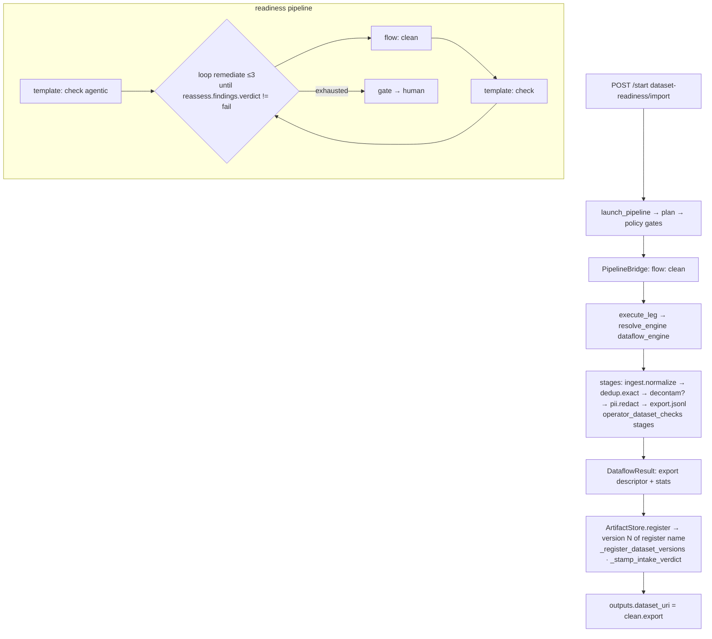

# Golden path — dataset preparation and readiness

## What this workflow does
Turns raw data into a hash-pinned, admitted dataset version: import (or pull), normalise,
dedup, decontaminate, redact PII, export, register with a readiness verdict; optionally
loop assess → repair → reassess with a human decision on non-convergence. Records:
`cairn/packs/dataset_readiness/pipelines/{import,readiness,pull-and-admit,api-and-admit,watch-source}.yaml`.

## Trigger
- Console Datasets → Add dataset → `POST /datasets/stage` then `POST /start {"ref": "dataset-readiness/import", "inputs": {"path": ..., "register": ...}}`.
- `cairn pipeline run dataset-readiness/import --set path=s3://… --set register=my-data`.
- `readiness` nightly `on: cron "0 3 * * *"` (materialised via `engine/pipeline_triggers.py`).
- A declared `watch` trigger (source `s3`/`table`/`dataset`) fires `watch-source` (`engine/triggers_grammar.py:624 watch_pipeline_inputs`).

## Execution diagram


## Exact source trace
```
launch                                 src/cairn/core/dispatch/pipeline_launch.py:161 launch_pipeline
  ├ def                                cairn/packs/dataset_readiness/pipelines/import.yaml
  ├ input type Dataset                 src/cairn/core/engine/pipeline.py:489 _leg_io_field_types (typed wires)
  └ start                              src/cairn/core/dispatch/pipeline_bridge.py:558
clean leg (flow: clean)                src/cairn/core/dispatch/pipeline_bridge.py:954 _submit_flow_leg
  ├ flow def                           cairn/packs/dataset_readiness/flows/clean.yaml (kind: data)
  ├ flow gate                          src/cairn/core/approval/enforce.py:173 enforce_flow_gate (aggregate risk of stages)
  ├ execute_leg                        src/cairn/core/dispatch/leg_executor.py:92
  │   ├ dataset: refs                  src/cairn/core/storage/artifacts.py:1186 parse_dataset_ref · :1238 resolve_dataset_refs_in_config
  │   ├ engine                         src/cairn/core/dataflow/engine_registry.py:102 resolve_engine(kind="data")
  │   ├ spec                           src/cairn/core/dataflow/contract.py:179 DataflowSpec (stages, config, budget)
  │   ├ submit                         operator_dataflow.engines (builtin runs cairn-dataflow-run; metaflow/skypilot adapters)
  │   │   └ stages by name             src/cairn/core/dataflow/defs.py:98 _stage_entry_points (cairn.dataflow_stages / cairn.flow_stages)
  │   │       ├ ingest.normalize       cairn/operators/official/dataset_checks/src/operator_dataset_checks/… (stage fns)
  │   │       ├ dedup.exact / dedup_minhash  same pack ([minhash] extra)
  │   │       ├ decontam               same pack (skips honestly when eval_path empty)
  │   │       ├ pii.redact             same pack; backend regex | duckdb | presidio ([pii] extra)
  │   │       └ export.jsonl           same pack → manifest (src/cairn/core/dataflow/manifest.py:36)
  │   ├ result                         DataflowResult.output_artifacts + stats
  │   ├ register version               src/cairn/core/storage/artifacts.py ArtifactStore.register (leg_executor.py:356)
  │   ├ dataset versions               src/cairn/core/dispatch/leg_executor.py:414 _register_dataset_versions
  │   ├ intake verdict                 src/cairn/core/dispatch/leg_executor.py:430 _stamp_intake_verdict → src/cairn/core/intake.py
  │   └ lineage parents                src/cairn/core/dispatch/leg_executor.py:463 _resolve_uri_parents
  └ outputs                            dataset_uri = clean.export (typed Dataset)
readiness pipeline
  ├ template: check                    cairn/packs/dataset_readiness/flows/check.md → dispatcher.run_template
  │   └ operators                      operator_dataset_checks: dataset/profile, dedup, decontam, pii_scan, gate (+ rag role data_governance)
  ├ loop: remediate                    src/cairn/core/engine/pipeline_loop.py · pipeline.py:_validate_step (max_iterations mandatory)
  └ on_exhausted: gate                 pipeline_bridge.py gate leg → review
ingestion variants
  ├ task: ingest/pull | ingest/api     cairn/operators/official/ingest/src/operator_ingest/operators/{pull,api}.py (SQLAlchemy/httpx, watermark)
  │   └ approve-pull HITL first        pipelines/pull-and-admit.yaml, api-and-admit.yaml
  └ watch                              operators/watch.py (ingest/watch) → monitor/propose → monitor/dispatch (operator_monitor_threshold)
downstream doors that read the result
  ├ holdout                            src/cairn/core/holdout.py (training refs vs holdout roles)
  └ intake                             src/cairn/core/intake.py check_intake_for_inputs (dispatcher.py run_template)
```

## Important state transitions
- Artifact versions: `register` name gets version N (content-addressed, immutable) with write-time stats, `role` (training/eval/holdout via `dataset_roles.py`), `intake` verdict, parents (lineage), tags (mutable; promotion attaches here).
- `Run` per leg with `template_ref="flow:dataset-readiness/clean"`.
- Watch marker committed on `StoredSchedule` row after admission (`ingest/watch commit: true`).
- Fingerprints published for later decontamination (`dataset/publish_fingerprints`, `storage/fingerprints.py`).

## Governance
Plan-time policy gates; flow gate on aggregate stage risk (`pii.redact`/`export` classes);
budget `{usd: 1}` reserved; ingestion pipelines start with an `approve-pull` HITL gate;
`watch-source` never starts downstream work unless `autostart` was explicitly declared
(`monitor/propose` files a proposal). Later training runs are refused by the intake and
holdout doors if the version is not admitted or intersects a holdout.

## Execution
Data engines (`builtin` default; `metaflow`/`skypilot` per profile); stage kernels in
`cairn-operator-dataset-checks`; rows never cross the control plane (manifests + scalars only).

## Output
`dataset:<register>@N` version, `outputs.dataset_uri`, stats on the version, console
Datasets view rows (`routers/datasets.py`), lineage graph.

## Tests
`tests/core/test_dataset_readiness_pack.py`, `test_dataflow_clean_template.py`,
`test_datasets_api.py`, `test_watch_source.py`, `test_artifact_registry.py`,
`test_leg_lineage_resolution.py`, `test_finetune_dataset_preflight.py`, `test_dataflow_defs.py`,
`test_dataflow_contract.py`, `test_inflow_policy_boundary.py`;
`cairn/operators/official/dataset_checks/tests/` (49 files);
`cairn/operators/official/ingest/tests/` (⚠ not in `testpaths`).

## Where to modify it
| Change | File |
|---|---|
| add a cleaning stage | `operator_dataset_checks` stage function + its `pyproject.toml` entry point + `flows/clean.yaml` stage list |
| change admission thresholds | `cairn/packs/dataset_readiness/flows/check.md` / operations; `src/cairn/core/intake.py` for the verdict rule |
| a new source kind | `cairn/operators/official/ingest/...`, `engine/triggers_grammar.py:197 WatchSource`, `pipelines/watch-source.yaml` |
| dataset ref syntax | `src/cairn/core/storage/artifacts.py:1186 parse_dataset_ref` (also read by `leg_executor.py` and `holdout.py`) |
