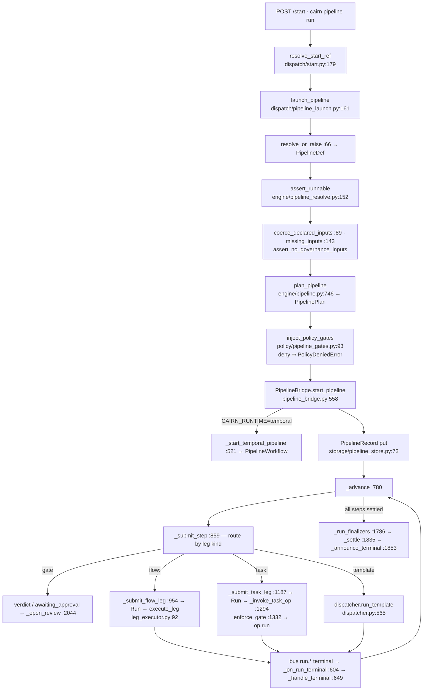

# Golden path — pipeline execution

## What this workflow does
Launches an installed `pipelines/*.yaml` and advances it leg by leg until terminal, each
leg a governed `Run`. Example: `serving/serve`, `dataset-readiness/import`, or any
`training/*` pipeline. This is the canonical path; the other golden paths are
specialisations of it.

## Trigger
- `POST /start {"ref": "<pack>/<pipeline>", "inputs": {...}, "kind": "pipeline"?}` (console launch dialog, `cairn-client`, MCP).
- `POST /pipelines/launch` (older door, same function).
- `cairn pipeline run <pack>/<name> --set k=v`.
- Cron/`on:` (`dispatch/scheduler.py:55 fire_scheduled_workflow`), a declared `watch` trigger, or the `monitor/dispatch` operator.

## Execution diagram


## Exact source trace
```
User: POST /start                                   src/cairn/core/triggers/routers/start.py:111  start_anything
  └ resolve kind                                    src/cairn/core/dispatch/start.py:179            resolve_start_ref(ref, kind)
      ├ workflow installed?                         src/cairn/core/dispatch/start.py:93             _workflow_installed
      └ pipeline installed?                         src/cairn/core/dispatch/start.py:108            _pipeline_installed
  └ pipeline                                        src/cairn/core/dispatch/pipeline_launch.py:161  launch_pipeline
      ├ resolve ref                                 src/cairn/core/dispatch/pipeline_launch.py:66   resolve_or_raise
      │                                             src/cairn/core/engine/pipeline_resolve.py:92    resolve_pipeline_ref
      ├ drift check (expected hash)                 src/cairn/core/dispatch/pipeline_launch.py:~190 PipelineDriftError
      └ launch_pipeline_def                         src/cairn/core/dispatch/pipeline_launch.py:210
          ├ assert_runnable                         src/cairn/core/engine/pipeline_resolve.py:152
          ├ preset resolution                       src/cairn/core/pipeline_presets.py               resolve_preset
          ├ governance inputs refused               (assert_no_governance_inputs)
          ├ coerce + missing inputs                 src/cairn/core/dispatch/pipeline_launch.py:89,143
          ├ plan                                    src/cairn/core/engine/pipeline.py:746           plan_pipeline → PipelinePlan
          │   └ lower_step / wires                  src/cairn/core/engine/pipeline.py:673,527
          ├ policy gates                            src/cairn/core/policy/pipeline_gates.py:93       inject_policy_gates  (call :277)
          └ start                                   src/cairn/core/dispatch/pipeline_bridge.py:558   PipelineBridge.start_pipeline
              ├ (temporal owner)                    src/cairn/core/dispatch/pipeline_bridge.py:521   _start_temporal_pipeline
              │                                     src/cairn/core/runtime/temporal/pipeline_workflow.py:63  PipelineWorkflow
              │                                     src/cairn/core/runtime/temporal/pipeline_activities.py:88 pipeline_submit_step
              ├ PipelineRecord                      src/cairn/core/storage/pipeline_store.py:73      (put via store)
              └ _advance                            src/cairn/core/dispatch/pipeline_bridge.py:780
                  ├ when/gate evaluation            src/cairn/core/dispatch/pipeline_bridge.py:693   _decide_loop · engine/pipeline_gate.py
                  └ _submit_step                    src/cairn/core/dispatch/pipeline_bridge.py:859
                      ├ gate leg                    :880-915  verdict data/approved · HITL → _pause_leg_for_approval :1035
                      ├ flow leg                    :954 _submit_flow_leg → :1134 _run_flow_leg → :1640 _execute_and_settle_flow_leg
                      │    ├ enforce_flow_gate      src/cairn/core/approval/enforce.py:173  (call :1121)
                      │    ├ leg side-channels      src/cairn/core/dispatch/leg_hooks.py
                      │    └ execute_leg            src/cairn/core/dispatch/leg_executor.py:92
                      │        ├ resolve flow       src/cairn/core/dataflow/defs.py:413  resolve_flow_ref
                      │        ├ dataset/judge refs src/cairn/core/storage/artifacts.py:1238 · storage/judges.py
                      │        ├ engine             src/cairn/core/dataflow/engine_registry.py:102 resolve_engine
                      │        ├ validate           DataflowEngine.validate   src/cairn/core/dataflow/engine.py:82
                      │        ├ reserve            src/cairn/core/budget_reservations.py  reserve  (call :281)
                      │        ├ submit/poll/result src/cairn/core/dataflow/engine.py:88/94/102 · _poll_until_terminal :492
                      │        ├ register artifacts src/cairn/core/storage/artifacts.py  ArtifactStore.register (calls :356-364)
                      │        └ settle/release     src/cairn/core/budget_reservations.py
                      ├ task leg                    :1187 _submit_task_leg → :1226 _run_task_leg → :1294 _invoke_task_op
                      │    └ enforce_gate           src/cairn/core/approval/enforce.py:116  (call :1332) → Operation.run
                      └ template leg                src/cairn/core/dispatch/dispatcher.py:565 run_template  (see operator.md)
  terminal
      ├ bus                                         src/cairn/core/bus/__init__.py  run.<type> topics
      ├ _on_run_terminal / _handle_terminal         src/cairn/core/dispatch/pipeline_bridge.py:604/649
      ├ _recompute_status                           :1864
      └ _settle / _announce_terminal                :1835 / :1853
```

## Important state transitions
| Object | Created | Updated | Terminal |
|---|---|---|---|
| `PipelineRecord` (`pipeline_store.py`) | at `start_pipeline` with plan snapshot, governance, `bundle_ref` | `step_state[step]` per leg, cursor, `status` (`running`/`paused`/…) | `done`/`failed`/`cancelled` |
| `Run` per leg (`storage/protocols.py:136`) | at leg submit with `bundle_pipeline_id`, `step_id`, `template_ref` (`flow:<pack>/<name>` for flow legs) | `running` → events | `done`/`failed`/`cancelled`/`awaiting_approval` |
| Budget reservation | at admission (`reserve`) | — | `settle(actual)` or `release` |
| Review row (HITL) | at gate pause | decision | approved/rejected |
| Artifacts | at flow-leg result | tags | immutable versions |

## Governance
Plan time: `inject_policy_gates`. Flow leg: `enforce_flow_gate` on aggregate stage risk +
budget reserve. Task leg: `enforce_gate` on operator risk/approval. Template leg: full
dispatcher admission + per-operation gate. HITL gates: `awaiting_approval` until
`approve` (`routers/pipelines.py`, `routers/run_control.py`; `/advance` refuses a gate with 409,
#2388). The approve route first holds the caller to a declared gate's `approvers:`
(`_assert_may_decide` → `approval/enforce.py approver_allowed`: username or role, owner/admin
always, unknown name → owner/admin only; 403 + audited `deny` — #2393, `08-governance.md`).

## Execution
Engines (flow), operators (task), LangGraph (template). The bridge never executes work; it
sequences and records.

## Output
`PipelineRecord` with rollup, per-leg `Run`s and events, `outputs:` resolved from leg
outputs, artifacts registered, bus events, console rows (`routers/pipelines.py:393 list_pipelines`).

## Tests
`tests/core/test_pipeline_launch.py`, `test_pipeline_bridge.py`, `test_pipeline_bridge_e2e.py`,
`test_pipeline_governance_wiring.py`, `test_policy_injected_gates.py`, `test_leg_executor.py`,
`test_leg_approval_gates.py`, `test_flow_leg_gate_guard.py`, `test_pipeline_drift_guard.py`,
`test_pipeline_leg_timeout.py`, `test_pipeline_artifacts.py`, `test_target_concurrency.py`,
`test_temporal_owner_leg_kinds.py`, `test_temporal_owner_readopt.py`, `test_run_template_ref.py`.

## Where to modify it
| Change | File |
|---|---|
| a new step field / kind | `src/cairn/core/engine/pipeline.py` (`PipelineStep`, `_validate_step`, `lower_step`) → `engine/bundle_pipeline.py` → `pipeline_bridge.py:_submit_step` (+ Temporal activities) |
| launch validation | `src/cairn/core/dispatch/pipeline_launch.py:launch_pipeline_def` |
| how a flow leg runs | `src/cairn/core/dispatch/leg_executor.py`, `leg_hooks.py` |
| how a task leg runs | `pipeline_bridge.py:_run_task_leg/_invoke_task_op` |
| gate semantics | `engine/pipeline_gate.py`, `pipeline_bridge.py:_decide_loop`, `approval/` |
| the HTTP shape | `triggers/routers/{start,pipelines,run_control}.py` + regenerate `console/openapi.json` |
