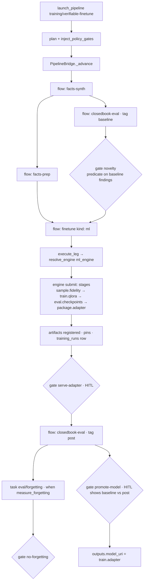

# Golden path — training (fine-tune)

## What this workflow does
Fine-tunes a base model on an admitted dataset under budget, measurement and human gates,
and produces a packaged adapter. Canonical record: `cairn/packs/training/pipelines/verifiable-finetune.yaml`
(synth facts → prep → baseline eval → novelty gate → train → serve-adapter HITL → post eval →
optional forgetting gate → promote HITL). The minimal record is `train-only.yaml`.

Two implementations exist ([../architecture/10-training.md](../architecture/10-training.md)):
the **ml flow** path (`flows/finetune.yaml`, `kind: ml`) used by the pipelines, and the
**agentic template** path (`flows/finetune.md`) used by `cairn run training/finetune` and the
`[[demo.finetune]]` tiers. This page traces the ml-flow path and points to the template
path where it diverges.

## Trigger
- `POST /start {"ref": "training/verifiable-finetune", "inputs": {...}}` from the console launch dialog.
- `cairn pipeline run training/train-only --set dataset_uri=dataset:my-data@3 --set base_model=...`.
- Template path: `cairn run training/finetune --input examples/...json` or `POST /start {"ref": "training/finetune"}`.

## Execution diagram


## Exact source trace
```
launch                                  src/cairn/core/dispatch/pipeline_launch.py:161 launch_pipeline
  ├ PipelineDef                         cairn/packs/training/pipelines/verifiable-finetune.yaml
  ├ TrainSpec at the input layer        (pipeline inputs: method, epochs, lora_r, … ADR-0102 D2)
  ├ plan + policy gates                 src/cairn/core/engine/pipeline.py:746 · src/cairn/core/policy/pipeline_gates.py:93
  └ PipelineBridge.start_pipeline       src/cairn/core/dispatch/pipeline_bridge.py:558
train leg (flow: finetune)              src/cairn/core/dispatch/pipeline_bridge.py:954 _submit_flow_leg
  ├ Run created                         template_ref = "flow:training/finetune"  (ADR-0084 D0)
  ├ flow gate                           src/cairn/core/approval/enforce.py:173 enforce_flow_gate (aggregate stage risk;
  │                                     train.qlora is paid compute → gated unless environment says otherwise)
  ├ execute_leg                         src/cairn/core/dispatch/leg_executor.py:92
  │   ├ flow def                        src/cairn/core/dataflow/defs.py:413 resolve_flow_ref
  │   │                                 cairn/packs/training/flows/finetune.yaml  (stages + $config.* wiring)
  │   ├ dataset refs → URIs            src/cairn/core/storage/artifacts.py:1238 resolve_dataset_refs_in_config
  │   ├ holdout probes                  src/cairn/core/holdout.py (holdout_eval_uris)
  │   ├ engine                          src/cairn/core/dataflow/engine_registry.py:83 selected_engine("ml") → :102 resolve_engine
  │   │                                 profile [profile.backends] ml_engine = builtin | metaflow | skypilot | ssh
  │   ├ validate                        DataflowEngine.validate  src/cairn/core/dataflow/engine.py:82
  │   ├ reserve                         src/cairn/core/budget_reservations.py reserve (series from governance:)
  │   ├ pins (via hooks / stages)       src/cairn/core/operator/pins.py:143 record_train_pins
  │   ├ submit                          packages/cairn-operator-dataflow/src/operator_dataflow/engines*.py
  │   │   └ job machine                 src/cairn/core/dataflow/runner.py (cairn-dataflow-run) loads stages by name:
  │   │       ├ sample.fidelity         cairn/operators/official/training/src/operator_training/flow_stages.py  (cairn.flow_stages)
  │   │       ├ train.qlora             same module → train_entry / trainer (torch/peft/trl on the box)
  │   │       ├ eval.checkpoints        same module (fail fast on checkpoint metrics)
  │   │       └ package.adapter         same module → adapter URI (hf | local | s3)
  │   ├ poll (heartbeat, checkpoint relay)   leg_executor.py:492 _poll_until_terminal · dispatch/leg_hooks.py · core/mid_training.py
  │   ├ result → descriptors            DataflowResult.output_artifacts  src/cairn/core/dataflow/contract.py:254
  │   ├ register                        src/cairn/core/storage/artifacts.py ArtifactStore.register (leg_executor.py:356)
  │   └ settle                          src/cairn/core/budget_reservations.py settle
  └ training history                    src/cairn/core/storage/training_runs.py (one row per run)
gates                                   pipeline_bridge.py:1035 _pause_leg_for_approval · :2044 _open_review
promotion (other pipelines)             model/register (cairn-operator-model-registry) · artifact/promote (cairn-operator-dataflow)
template path (cairn run training/finetune)
  ├ compile                             src/cairn/core/engine/compiler.py:92 ← cairn/packs/training/flows/finetune.md
  ├ subgraph dataset-readiness/check    compiler.py:1043 _flatten_subgraph (cross-pack, warns :1115)
  ├ operations                          cairn/packs/training/operations/run-{cost-estimate,cost-gate,train,…}.yaml
  └ providers                           cairn/operators/official/training/src/operator_training/operators/{stub,local,modal,kaggle,runpod,vast}.py
```

## Important state transitions
- `PipelineRecord.step_state[train]`: queued → running (engine handle persisted by `on_submit`) → done/failed; retry per `retry: {max_attempts: 2}` resumes from the relayed checkpoint (ADR-0086 H6).
- `Run` for the train leg: `template_ref="flow:training/finetune"`, `train_pins` (dataset hash, image digest, spec), `cost` (gpu_usd via cost-actual on the template path).
- Artifacts: adapter (`Model`), metrics (`Report`), dataset versions consumed/produced with lineage parents.
- `training_runs` row; MLflow run when `report_to: [mlflow]` (external).
- HITL gates `serve-adapter`, `promote-model` → `awaiting_approval`, review rows.

## Governance
Plan-time policy gates; `novelty` data gate (base model must not already know the facts);
flow gate on paid-compute risk; series budget `{usd: 50}` reserved before submit; license
door for gated catalog models (`accept_license`); holdout door on training data; two HITL
gates; forgetting gate opt-in.

## Execution
On the environment's `ml_engine`: `builtin` (local process / SSH box), `metaflow`
(ADR-0089, steps + resume), `skypilot` (rented GPU, ADR-0104). The control plane never
imports torch; the box installs `cairn-operator-training[local|gpu]`.

## Output
`outputs.model_uri` = the adapter URI; baseline/post findings on the promote card; the run
bundle (`src/cairn/core/run_bundle.py`) for reproduction.

## Tests
`tests/core/test_verifiable_finetune_pipeline.py`, `test_training_pack.py`, `test_train_pins.py`,
`test_training_history.py`, `test_mid_training.py`, `test_finetune_dataset_preflight.py`,
`test_flatten_finetune.py`, `test_wire_finetune_remote_compile.py`, `test_checkpoint_relay_resume.py`,
`test_leg_executor.py`; `cairn/operators/official/training/tests/test_flow_stages.py`,
`test_trainer_pins.py`, `test_checkpoint_sync.py`, `test_validate_mode.py`, `test_local_entry.py`;
`packages/cairn-operator-dataflow-metaflow/tests/test_metaflow_train_bridge.py`;
`packages/cairn-operator-dataflow-skypilot/tests/test_skypilot_engine.py`.

## Where to modify it
| Change | File |
|---|---|
| a training hyper-parameter | `operator_training/schemas/train.py` (`TrainSpec`) → `flows/finetune.yaml` `$config` wiring → pipeline `inputs:` (ADR-0102 D2 says the whole spec is tunable at the input layer) |
| the training algorithm | `cairn/operators/official/training/src/operator_training/flow_stages.py` / `train_entry` (+ `DESIGN.md`, pack tests) |
| which engine runs training | profile `[profile.backends] ml_engine`; engine impls in `operator_dataflow/engines_*.py` |
| gates in the pipeline | `cairn/packs/training/pipelines/*.yaml` (+ `uv run cairn lock`) |
| pins / provenance | `src/cairn/core/operator/pins.py`, `src/cairn/core/storage/training_runs.py` |
