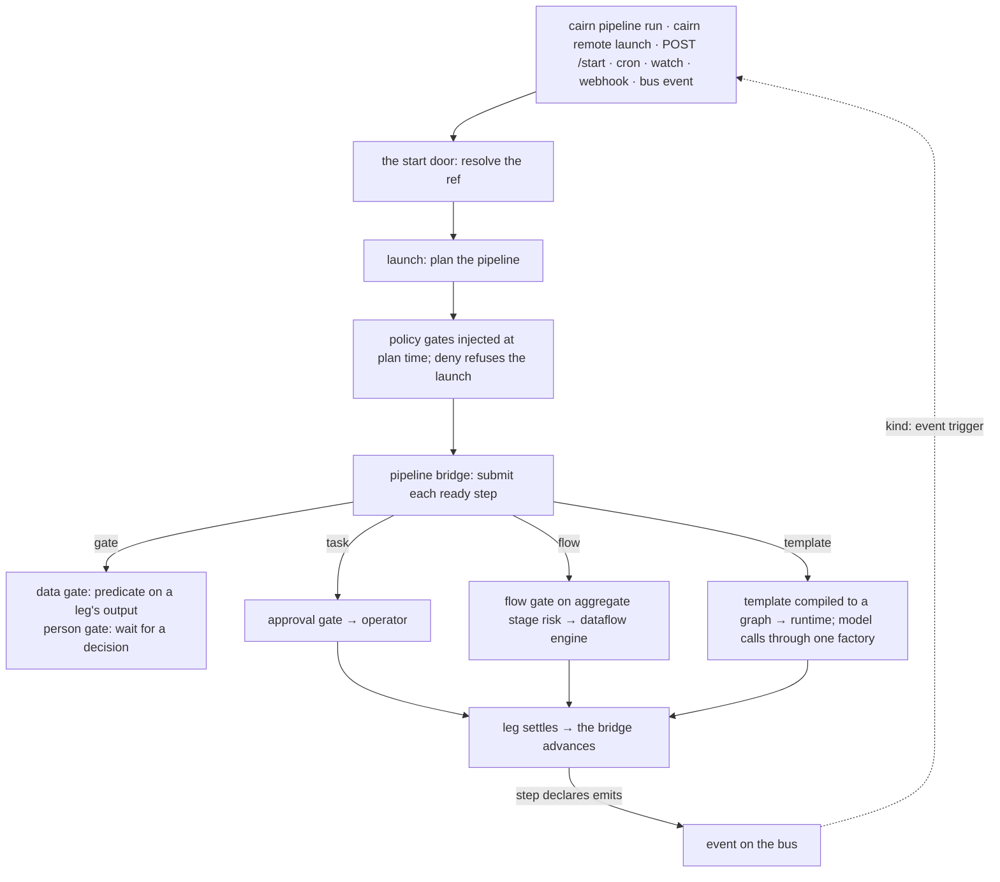

cairn is built around a strict one-way dependency: a **domain-neutral engine**
plus **packs** that carry all domain knowledge and **operators** that do the
work. The engine never imports a pack or an operator package; it finds them
through Python entry-point groups.

## Three layers

| Layer | What it holds | Example |
|---|---|---|
| **Pack** | *intent*: pipelines, flows, policies, corpora, data | `hello-cairn`'s `profile-and-publish` pipeline |
| **Profile** | *technology choices*: which operator backs each capability (`[profile.bindings]`), which engines run flows | bind `secrets.store` to `secrets/env` or to `secrets/infisical` |
| **Environment** | *glue*: secrets, endpoints, and the engine's settings | `OPENAI_API_KEY`, `CAIRN_STORAGE` |

A pack declares *what* it needs; a profile decides *which* operator satisfies
it; the environment supplies the credentials. The same pack runs against
different backends by changing the profile. See
[Profiles](/concepts/profiles-environment/).

## Packages

- **The engine** (`cairndev`, import name `cairn`): dispatch, the pipeline
  planner, the template compiler, the runtimes, governance, storage, the HTTP
  server and the CLI.
- **Builtin operator packs** (`cairn-operator-*`): the operators the engine's
  own services bind to (storage, audit, redaction, memory, RAG, MCP, secrets,
  monitor, remote execution, the dataflow engine, local training). See
  [Builtin operators](/reference/operators/).
- **Contracts** (`cairn-contracts-*`): the capability contracts the builtin
  operators implement (`contract://storage.put/1.0.0` and so on).
- **The example pack** (`cairn-pack-hello`): a domain pack is data plus a
  little glue (a run hook, a stdio MCP server), never operators.
- **Clients**: `cairn-client` (the HTTP API) and `cairn-sdk` (authoring
  pipelines in Python).

## The path a launch takes

1. **One door.** Every start, manual or triggered, goes through the same start
   door. Only a declared pipeline runs: a bare flow ref is refused, and a
   pipeline wins over a flow at the same ref.
2. **Plan.** The pipeline is planned, and the environment's policies insert the
   gates they require before any record exists. A `deny` refuses the launch.
3. **Legs.** The pipeline bridge submits each ready step. Every task, flow and
   template leg is **its own run**; its identity is recorded when it is
   admitted and never re-derived.
4. **Governance on every leg.** Every operator call passes the approval gate;
   a flow leg passes the flow gate on its stages' aggregate risk; every model
   call is built by one factory, where redaction and cost attach.
5. **Artifacts.** A flow engine reports what a leg produced as descriptors; the
   control plane registers them. Rows never cross the control-plane boundary.
6. **Advance.** When a leg settles, the bridge evaluates the next gates and
   submits what is ready. A step that declares `emits` publishes its event.

## Engine subsystems

- **dispatch** — the start door, the launch, the pipeline bridge, the leg
  executor, the scheduler and the event-trigger listener.
- **engine** — the pipeline planner, the template compiler, the expression
  language and the trigger grammar.
- **approval / policy** — gate resolution (operator ∪ profile ∪ policy ∪
  binding, strictness only), the approval reaper, plan-time policy gates.
- **runtime** — `inprocess`, `dbos` and `temporal`, the LangGraph checkpointer
  tiers and the reconciler.
- **dataflow** — the engine contract flow legs run on.
- **storage** — runs, pipelines, the artifact registry and the config stores,
  on SQLite or Postgres.
- **obs** — cost, events, redaction and the hash-chained audit seam.
- **pack / operator** — the pack contract, discovery and registry, profiles,
  and the operator contract.
- **triggers** — the HTTP server, auth and webhook receivers.

## Surfaces

One FastAPI server (`cairn-server`, port `CAIRN_TRIGGER_PORT`, default 9090)
serves the HTTP API: the start door, runs, pipelines and their gates,
schedules and webhook receivers. The CLI drives the same server over HTTP
(`cairn remote …`) or launches a pipeline from a local process
(`cairn pipeline run`). Every route can also be addressed per workspace as
`/workspaces/{id}/…`.

The web console and the AI-assisted planner are part of cairn-platform; they
reach the engine through the same API and entry-point groups.

## Further reading

The repository's `docs/` tree holds the contributor material: the
architecture documents, the contract specifications, the accepted decision
records (ADRs) and the support matrix.
