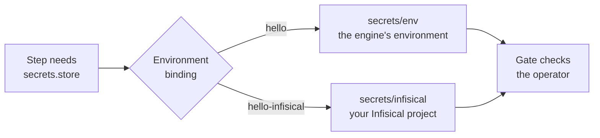

Pipelines and flows say **what** kind of work a step needs. The environment
decides **which** tool does it. That split is what lets the same pipeline run
against a local store on a laptop and against real providers in a deployment
without changing a line.



## Capabilities and operators

An **operator** is the code that talks to one tool or provider. Each operator
declares, in its pack's `pack.toml`:

- the **capabilities** it provides, such as `storage.put`, `secrets.store` or `train.finetune`;
- its **risk**: `read_only`, `external_write`, `paid_compute` or `production_mutation`;
- where it can execute (`in_process`, `remote_job`), whether it has a mock
  path, and whether it asks for approval on every call.

Several operators can provide the same capability. `secrets.store`, for
example, is provided by `secrets/env` (environment variables) and
`secrets/infisical` (an Infisical project). The
[operators reference](/reference/operators/) lists every operator that ships
with cairn.

Operators ship as their own Python packages. cairn finds an operator package
through its `cairn.operators` entry point once it is installed, and not
before. `cairn init operator` scaffolds one.

## Environments

An **environment** is a profile: a TOML file that binds capabilities to
operators and picks the backends a run uses. You choose one when you launch
(`--environment sandbox`), and a deployment names its base profile with
`CAIRN_PROFILE`.

| Profile | What it is |
|---|---|
| `sandbox` | The environment a fresh install offers. No credentials, no remote compute: the in-process runtime and the built-in data and ML engines. |
| `local-dev` | The base layer `sandbox` extends, and what `cairn dev` uses when `CAIRN_PROFILE` is unset. |
| `secure` | `local-dev` plus redaction before every model call and the hash-chained audit trail. The Docker Compose stack runs it. |
| `prod-infisical` | `secure` with secrets read from Infisical. |

A binding maps a capability to the operator that provides it. These are the
bindings of `local-dev`:

```toml
[profile.bindings]
"memory.search"  = "memory/search"   # cairn-operator-memory-local
"memory.write"   = "memory/write"    # cairn-operator-memory-local
"storage.put"    = "storage/put"     # cairn-operator-artifact-local
"storage.get"    = "storage/get"     # cairn-operator-artifact-local
"rag.search"     = "rag/search"      # cairn-operator-rag-local
"rag.fetch"      = "rag/fetch"       # cairn-operator-rag-local
"mcp.call"       = "mcp/call"        # cairn-operator-mcp
```

A profile overrides only the bindings it needs. The example pack's
`profiles/hello.toml` adds `"secrets.store" = "secrets/env"`, and
`profiles/hello-infisical.toml` binds the same capability to
`secrets/infisical`; nothing in the pipeline changes. A profile also picks the
engines:

```toml
[profile.backends]
dataflow_engine = "builtin"     # or "metaflow", "skypilot" with their extras installed
ml_engine       = "builtin"
```

Selecting the Metaflow or SkyPilot engine without its package installed is
refused at launch, naming the extra to install.

## The sandbox

The `sandbox` environment has nothing to spend with: no keys, no remote
compute, no durable runtime. A run started in **sandbox mode**
(`cairn run --mode sandbox`) goes further: an operator runs for real only if
it is free of side effects (a read or an analysis). Every other operator that
has a mock path takes it, so reads give real numbers while writes and spend
are stubbed wherever the operator offers a stub.

## The gate checks the operator

Every operator call passes one enforcement function before it runs. It asks
for approval when the operator itself requires it, or when a policy that
matches the call says `require_hitl` or `deny`. A flow leg is checked once,
on the highest risk among its stages: when an approval is required, the leg
pauses as **awaiting approval** before the engine is touched.

`cairn pipeline explain <ref>` prints, for each leg, the operator or engine
that will run it, its risk, and which gate (if any) applies and why.

## Next

- [Gates and approvals](/concepts/gates/): every way a pipeline waits.
- [Connect a provider](/guides/connect-a-provider/): models, connections and secrets.
- [Operators](/reference/operators/): the shipped operators and their capabilities.
