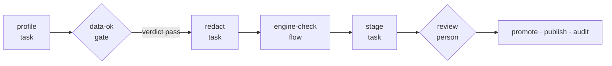

A **pipeline** is the unit you launch. It is a YAML file that names the legs
to run, the order they run in, and the gates between them. Only a declared
pipeline runs: there is no other way to start work in cairn.

## Legs

A pipeline is a list of **legs**. Each leg has an `id` and exactly one kind.

| Kind | What the leg does | Has its own run |
|---|---|---|
| `flow:` | runs a data or ML [flow](/concepts/flows/) on a dataflow engine | yes |
| `template:` | runs an agentic flow (a markdown flow) | yes |
| `task:` | calls one [operator](/concepts/capabilities/) directly | yes |
| `gate:` | stops until a predicate passes or a person approves | no |
| `loop:` | repeats a group of legs until a condition holds, with a hard limit | no |

A leg that does work (flow, template, task) becomes its own **run**: its own
status, cost and record, launched through the same admission checks as any
other run. A gate has no run; its verdict and approver are stored on the
pipeline. [Gates and approvals](/concepts/gates/) covers them in full.

Legs run in the order of `depends_on`. A leg with no `depends_on` waits for the
leg written before it. A leg with a `when:` condition that is false is skipped
and the pipeline carries on.

Inside a flow, the units of work are **steps**: the stages of a data flow, or
the nodes of an agentic flow.

## An example

The example pack's `hello-cairn/profile-and-publish` pipeline checks a
dataset, stops if the check fails, and publishes a summary only after a person
approves:



Abridged from `examples/hello-cairn/pipelines/profile-and-publish.yaml`:

```yaml
steps:
  - id: profile
    task: data/profile
    with:
      source: $input.path
      expectation: $input.expectation

  - gate: data-ok
    depends_on: [profile]
    predicate: steps.profile.verdict == 'pass' && steps.profile.record_count >= input.min_rows

  - id: redact
    task: redact/text
    depends_on: [data-ok]
    with:
      text: $steps.profile.note

  - id: engine-check
    flow: engine-check
    depends_on: [redact]
    with:
      source: $input.path
      register: hello-sample

  - id: stage
    task: storage/put
    depends_on: [engine-check]
    with:
      store: hello-staging
      key: summary
      content: $steps.redact.text

  - gate: review
    depends_on: [stage]
    approvers: data-owners
    show: [profile.verdict, profile.record_count, redact.text, stage.uri]
```

Values are wired with expressions. `$input.<name>` reads a pipeline input and
`$steps.<leg>.<field>` reads an earlier leg's output. The whole value must be
the expression; there is no string interpolation. The
[YAML reference](/reference/yaml/) lists every field.

## The launch door

`cairn pipeline run`, `cairn remote launch`, `POST /start` on the HTTP API and
a trigger all start a pipeline through the same launch code. In order, it:

1. resolves the reference (`<pack>/<name>`, optionally prefixed `pipeline:`),
2. checks the inputs and coerces them to their declared types,
3. applies policy: a policy can insert an approval gate before a leg, or
   refuse the launch outright,
4. runs admission checks (for example, a policy can require that the dataset
   version a pipeline trains on passed named checks),
5. only then writes the pipeline record and starts the first legs.

A launch refused in steps 1 to 4 leaves no record behind.

A pipeline record moves through `queued`, `running`, `paused` (something is
waiting for a person), and ends `done`, `failed` or `cancelled`.

## Triggers belong to pipelines

A pipeline can declare how it starts without a person: a schedule, a webhook,
a watch on a dataset, or an event another pipeline emits. Flows cannot: a flow
only runs as part of a pipeline.

```yaml
triggers:
  - kind: schedule
    cron: "0 6 * * 1"
    enabled: false
  - kind: webhook
    source: custom
    path: /triggers/hello-sample
    enabled: false
```

When the engine starts, it installs every pipeline it finds into the
`default` workspace and arms its declared triggers. A schedule, watch or event
trigger fires only when its declaration says `enabled: true`, so installing a
pack never starts unattended spend by surprise. A fired trigger goes through
the same launch door as a person. The [YAML reference](/reference/yaml/#triggers)
lists every kind and field.

## Next

- [Flows](/concepts/flows/): the components legs run.
- [Gates and approvals](/concepts/gates/): data gates, person gates and policy gates.
- [Write a pipeline](/guides/write-a-pipeline/): build one step by step.
