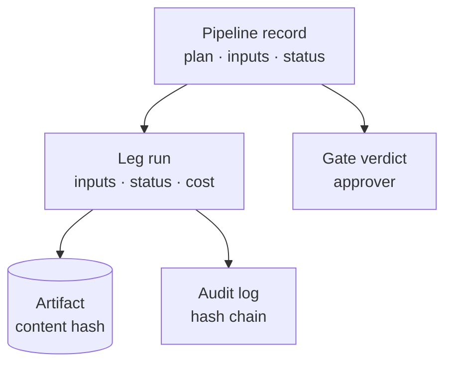

Everything cairn launches leaves a record you can read later: what ran, with
which inputs, in which environment, who approved it, what it produced and what
it cost.

## The pipeline record

Each launch writes one pipeline record (`pl_…`). It holds:

- the **plan**: the legs and gates exactly as resolved at launch, including any
  gate a policy added;
- the **inputs**, the **environment**, what triggered it, and its governance
  (budget, series, approvers);
- for every leg: its status, the id of its run, the gate verdict and the
  approver, and when it started, waited and ended;
- the pipeline status: `queued`, `running`, `paused`, `done`, `failed` or
  `cancelled`.

A paused pipeline is stored, not held in memory. After a restart cairn picks up
the running and paused pipelines again; a gate that was waiting is still
waiting.

## Leg runs

Every flow, template or task leg is its own run. A run records the flow or
operator it ran (fixed when the run was admitted, never worked out again
later), its inputs and environment, its status, its results, and its cost split
into model calls, GPU and storage. A run can name the run it was derived from,
so a chain such as evaluate, fix, fine-tune, promote stays linked.

## Artifacts

An engine never sends rows back to cairn. It returns a description of each
output (its location, kind, content hash, size, row count, schema and the
artifacts it came from), and cairn registers that description as an
**artifact**. An artifact's id is its content hash, and the record does not
change once written. Dataset versions and tags sit on top of artifacts, so a
dataset version always points at one exact file.

## The audit trail

With the audit trail on, cairn appends security-relevant events to a log in
which every row carries `sha256(previous hash + row)`. Changing or deleting a
row breaks every hash after it. The log records operator approvals inside
flows, model calls, actions and artifact changes. Pipeline gate decisions live
on the pipeline record, as above.

The audit trail is part of the environment: it is on when the profile binds
`audit.sink` to the `audit/store` operator. The `secure` profile does, and so
does the Docker Compose stack; `sandbox` and `local-dev` do not. A pipeline
can also write an audit row as a leg of its own, as the example's
`profile-and-publish` does with `task: audit/store`. The log file is
`CAIRN_AUDIT_LOG` (`./audit.jsonl` when unset).

## Reading it back

| Where | What you get |
|---|---|
| `cairn remote pipeline <id>` | a pipeline's full record from a server, as JSON: plan, inputs, governance, every step's state |
| `cairn remote findings <id>` | every leg's outputs for a pipeline |
| `cairn remote ps` · `cairn remote status <run-id>` · `cairn remote logs <run-id>` | the runs on a server, one run's record, its event log |
| `cairn replay <run-id>` | a past run's recorded event trace, rendered as a timeline; it does not run anything again |
| `cairn lineage [subject]` | lineage records in the audit log, with the hash chain checked as it reads |
| `GET /pipelines/<id>` · `GET /pipelines/<id>/findings` | the same over the HTTP API |

The operator that writes lineage records is part of cairn-platform, as is the
console's pipeline and run pages.

## Next

- [Gates and approvals](/concepts/gates/): how verdicts get onto the record.
- [Cost and budgets](/concepts/cost/): how cost is capped and recorded.
- [CLI reference](/reference/cli/): the commands above in full.
